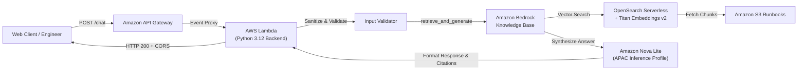
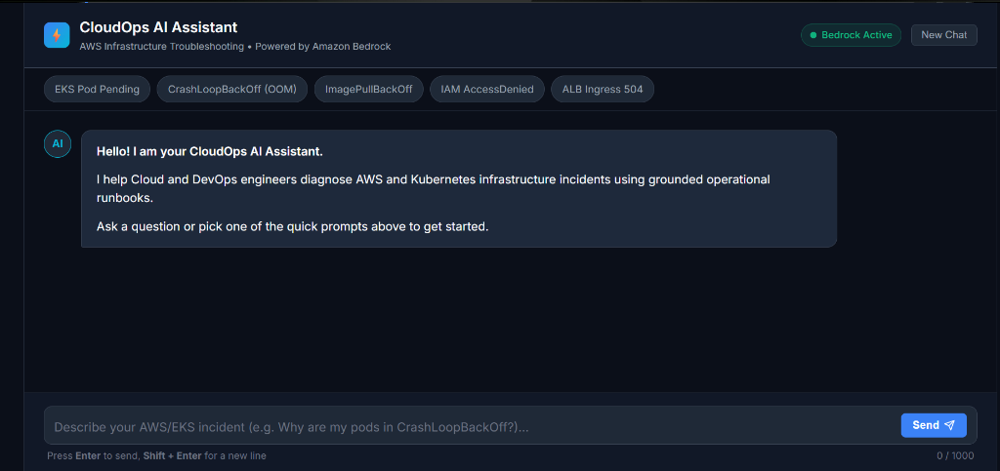
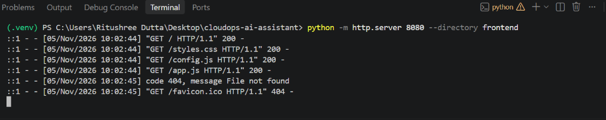

# CloudOps AI Assistant — AWS Infrastructure Troubleshooting Chatbot

An AI-powered troubleshooting assistant built on **Amazon Bedrock** designed to help Cloud and DevOps engineers diagnose AWS and Kubernetes infrastructure incidents (such as EKS pod scheduling failures, CrashLoopBackOff, IAM AccessDenied, and API Gateway 503 errors) using grounded operational runbooks and architecture documentation.

---

## 🏗️ Architecture Overview


### End-to-End Request Flow



---

## 📊 Milestone Progress Tracker

| Milestone | Scope | Status | Evidence / Artifact |
| :--- | :--- | :---: | :--- |
| **Phase 1** | **Bedrock Knowledge Base & RAG Grounding**<br>• 5 EKS Runbooks<br>• S3 Ingestion & OpenSearch Serverless<br>• Nova Lite Inference Profile Integration | ✅ **Completed** | [Phase 1 Summary](PHASE_1_SUMMARY.md) & Screenshots |
| **Phase 2** | **Serverless Python Backend**<br>• Modular Lambda handler (`handler.py`)<br>• Input validation & prompt injection sanitization<br>• Citation deduplication & CORS formatting<br>• 21 unit tests (100% offline verification) | ✅ **Completed** | Full test suite in `backend/tests/` |
| **Phase 3** | **Infrastructure as Code (Terraform)**<br>• Modular IaC for IAM, Lambda packaging, and API Gateway<br>• Automated zip bundling, CORS & cost throttling safeguards | ✅ **Completed** | `terraform/` (Validated) |
| **Phase 4** | **Frontend Web Interface**<br>• Responsive dark-mode DevOps UI with citation drawer & one-click command copy<br>• Session continuity & offline fallback simulation | ✅ **Completed** | `frontend/` (Verified) |
| **Phase 5** | **Evaluation & Observability**<br>• 25-question incident evaluation benchmark & CloudWatch alarms | 🟡 **Next** | `eval/` |

---

## 🟢 Phase 1: Knowledge Base & RAG Grounding

In Phase 1, we established and verified the core RAG pipeline connecting Amazon S3 runbooks to Amazon Bedrock.

### Key Configuration
| Component | Identifier / Value | Description |
| :--- | :--- | :--- |
| **AWS Account ID** | `713881796636` | Dedicated AWS account |
| **AWS Region** | `ap-south-1` (Mumbai) | Target deployment region |
| **S3 Runbook Store** | `s3://cloudops-runbooks-713881796636/docs/eks/` | Source markdown runbook store |
| **Knowledge Base ID** | `IZBE4IPYRY` | Bedrock Knowledge Base |
| **Embeddings Model** | `Amazon Titan Text Embeddings v2` | Vector generation (1024 dims) |
| **Vector Store** | `Amazon OpenSearch Serverless` | Auto-managed vector index |
| **Inference Profile** | `arn:aws:bedrock:ap-south-1:713881796636:inference-profile/apac.amazon.nova-lite-v1:0` | APAC System Cross-Region Profile for Nova Lite |

### Verified Results & Proof of Grounding

#### 1. Grounded Output for `CrashLoopBackOff`:


#### 2. S3 Granular Source Citations:


---

## 🟢 Phase 2: Serverless Python Backend

In Phase 2, we built a modular, production-ready, and unit-tested AWS Lambda backend that interfaces cleanly with Amazon API Gateway.

### Backend Architecture (`backend/src/`)

```text
backend/
├── src/
│   ├── __init__.py
│   ├── handler.py                 # Lambda entrypoint & API Gateway event proxy
│   ├── validator.py               # Input validation & prompt injection sanitization
│   ├── kb_service.py              # Bedrock Agent Runtime client (lazy-loaded)
│   └── response_formatter.py      # Citation extractor & CORS HTTP response builder
├── tests/
│   ├── __init__.py
│   ├── test_handler.py            # API Gateway event & HTTP status tests
│   ├── test_kb_service.py         # Mocked Bedrock SDK & error handling tests
│   ├── test_response_formatter.py # CORS framing & citation deduplication tests
│   └── test_validator.py          # Boundary & prompt injection tests
├── requirements.txt               # boto3, botocore, pydantic, pytest
└── test_local_lambda.py           # Local simulator for API Gateway events
```

### Module Responsibilities

1. **`validator.py`**:
   - Rejects empty bodies and non-string messages.
   - Enforces length bounds (`3 <= len(message) <= 1000`).
   - Blocks prompt injection attempts using regex patterns (`ignore prior instructions`, `system: you are now`, etc.).
   - Validates optional `sessionId` strings (up to 128 chars).

2. **`response_formatter.py`**:
   - Attaches standard CORS headers (`Access-Control-Allow-Origin: *`, `POST, OPTIONS`).
   - Deduplicates overlapping citations returned by Bedrock.
   - Converts raw S3 URIs into readable titles (e.g. `pod-pending.md` $\rightarrow$ `"Pod Pending"`).
   - Truncates long text snippets cleanly for UI card rendering.

3. **`kb_service.py`**:
   - Encapsulates `bedrock-agent-runtime.retrieve_and_generate`.
   - Uses lazy client loading for fast Lambda warm-start invocations.
   - Translates AWS `ClientError` (e.g. `ThrottlingException`, `AccessDeniedException`) into structured errors.

4. **`handler.py`**:
   - Entrypoint for API Gateway REST (v1) and HTTP API (v2) payloads.
   - Handles CORS preflight (`OPTIONS`) requests immediately with HTTP 200.
   - Orchestrates validation $\rightarrow$ Bedrock invocation $\rightarrow$ response formatting.
   - Returns strict HTTP status codes: `200 OK`, `400 Bad Request`, `500 Config Error`, `502 Bedrock Error`.

---

## 🧪 Testing & Verification

### Running the Test Suite (21 Unit Tests)
The entire backend is verified with unit tests using mocks for 100% offline testing without incurring AWS charges:

```powershell
pytest backend/tests/ -v
```

```text
============================= test session starts =============================
collected 21 items

backend/tests/test_handler.py::test_cors_preflight_options_rest_api PASSED
backend/tests/test_handler.py::test_cors_preflight_options_http_api_v2 PASSED
backend/tests/test_handler.py::test_missing_body PASSED
backend/tests/test_handler.py::test_malformed_json_body PASSED
backend/tests/test_handler.py::test_validation_error_short_message PASSED
backend/tests/test_handler.py::test_bedrock_runtime_error_returns_502 PASSED
backend/tests/test_handler.py::test_successful_query_flow PASSED
backend/tests/test_kb_service.py::test_missing_kb_id_raises_value_error PASSED
backend/tests/test_kb_service.py::test_successful_query_mock PASSED
backend/tests/test_kb_service.py::test_client_error_handling PASSED
backend/tests/test_response_formatter.py::test_build_http_response_structure PASSED
backend/tests/test_response_formatter.py::test_build_http_error_response PASSED
backend/tests/test_response_formatter.py::test_format_citations_empty PASSED
backend/tests/test_response_formatter.py::test_format_citations_extraction_and_deduplication PASSED
backend/tests/test_validator.py::test_valid_request PASSED
backend/tests/test_validator.py::test_valid_request_with_session PASSED
backend/tests/test_validator.py::test_empty_or_none_body PASSED
backend/tests/test_validator.py::test_missing_message_field PASSED
backend/tests/test_validator.py::test_message_too_short PASSED
backend/tests/test_validator.py::test_message_too_long PASSED
backend/tests/test_validator.py::test_prompt_injection_rejection PASSED

============================= 21 passed in 0.15s =============================
```

### Running the Local API Gateway Simulator
To simulate how the Lambda handler processes an API Gateway request:

```powershell
python backend/test_local_lambda.py
```

---

## 🟢 Phase 3: Infrastructure as Code (Terraform)

In Phase 3, we codified the entire serverless infrastructure into reusable, modular Terraform with zero-cost teardown capabilities.

### Modular Architecture (`terraform/`)

```text
terraform/
├── environments/
│   └── dev/
│       ├── main.tf          # Root orchestrator wiring modules together
│       ├── variables.tf     # Configurable inputs (region, KB ID, Model ARN)
│       ├── outputs.tf       # API endpoint URL & Lambda details
│       └── terraform.tfvars # Dev environment values
└── modules/
    ├── iam/                 # Least-privilege Lambda execution role & policies
    │   ├── main.tf
    │   ├── variable.tf
    │   └── output.tf
    ├── lambda/              # Automated code zip packaging & Lambda function
    │   ├── main.tf
    │   ├── variable.tf
    │   └── output.tf
    └── api_gateway/         # HTTP API (v2), POST /chat route, CORS & rate throttling
        ├── main.tf
        ├── variable.tf
        └── output.tf
```

### Module Responsibilities & Security Safeguards

1. **`modules/iam/`**:
   - Enforces **Least Privilege**: grants `bedrock:RetrieveAndGenerate` strictly on the target Knowledge Base ARN and basic CloudWatch logging.
   - **Zero infrastructure modification permissions**: no EC2, EKS, or S3 write access.

2. **`modules/lambda/`**:
   - Automatically packages `backend/src/` into a deployment zip using `data "archive_file"`.
   - Uses `source_code_hash` to detect file changes and deploy code updates idempotently.
   - Sets execution timeout (30s) and memory (256MB) with a 14-day CloudWatch log retention policy.

3. **`modules/api_gateway/`**:
   - Deploys a cost-effective **HTTP API (v2)** with native CORS headers (`allow_origins = ["*"]`).
   - Configures Lambda Proxy integration for `POST /chat` and preflight `OPTIONS /chat`.
   - **Cost Safeguard:** Implements stage throttling (`rate_limit = 5 req/s`, `burst_limit = 10`) to eliminate denial-of-wallet risks.

### Terraform Lifecycle Commands

```powershell
# 1. Navigate to dev environment
cd terraform/environments/dev

# 2. Format & Initialize providers (AWS ~> 5.0, Archive ~> 2.4)
terraform init

# 3. Validate syntax and module wiring
terraform validate

# 4. Preview resource provisioning
terraform plan

# 5. Deploy to AWS
terraform apply

# 6. Teardown completely (Zero ongoing charges)
terraform destroy
```

---

## 🟢 Phase 4: Frontend Web Interface (Chat UI)

In Phase 4, we built a modern, responsive single-page web interface tailored for Cloud and DevOps engineers troubleshooting AWS/EKS incidents.

### Frontend Structure (`frontend/`)

```text
frontend/
├── index.html        # Semantic HTML layout with prompt chips & chat viewport
├── styles.css        # Modern dark-mode DevOps aesthetic (Terminal styling)
├── app.js            # API caller, markdown parser, citation cards & copy button logic
└── config.js         # API Gateway endpoint URL & fallback configuration
```

### Key UI Features

1. **Terminal-Style Dark Mode Theme:**
   - Sleek dark theme (`#0b0f19`) matching modern DevOps tools and AWS Console dark mode.
   - Status badge showing Bedrock connectivity state.
2. **One-Click Command Copy:**
   - Automatically detects bash/CLI code blocks (such as `kubectl describe pod` or `aws iam`) and injects a "Copy" button.
3. **Interactive Runbook Citation Cards:**
   - Displays clean, clickable source pills (e.g. `Pod Pending`, `Crashloopbackoff`) for every cited runbook.
   - Clicking a pill reveals the exact S3 URI location and retrieved context snippet.
4. **Quick Starter Prompts:**
   - Clickable chips for common issues: *EKS Pod Pending*, *CrashLoopBackOff (OOM)*, *ImagePullBackOff*, *IAM AccessDenied*, *ALB Ingress 504*.
5. **Session Continuity & Safe Fallback:**
   - Manages unique conversation `sessionId` across user turns so multi-turn troubleshooting retains context.
   - Includes built-in simulated fallback so the UI can be opened directly in any browser for immediate demonstration.

### Running the Frontend Locally

You can launch the frontend directly in your browser:
```powershell
# Option A: Open directly in your default browser
Start-Process "frontend/index.html"

# Option B: Serve via Python static HTTP server
python -m http.server 8080 --directory frontend
# Then open http://localhost:8080 in your browser
```

### 📸 Verified UI Deployment & Live Preview

#### 1. CloudOps AI Assistant Chat Interface (Dark-Mode DevOps Theme)
The web client initialized with Bedrock status active, quick prompt starter chips, and clean input container with character limits:



#### 2. Local HTTP Server & Static Asset Delivery (Port 8080)
Verified static file delivery (`index.html`, `styles.css`, `config.js`, and `app.js` returning HTTP 200 OK):



---

## 🚀 Next Milestone: Phase 5 (Evaluation & Observability)

Phase 5 will establish automated quality assurance and production monitoring:
- **Curated Benchmark Dataset (`eval/test_dataset.json`):** 25-30 realistic incident scenarios covering EKS, IAM, and API Gateway.
- **Evaluation Runner (`eval/evaluate_retrieval.py`):** Benchmarks retrieval relevance, answer groundedness, latency, and token cost.
- **Published Metrics:** Hard data published to `eval/eval_results.md` demonstrating production quality.
