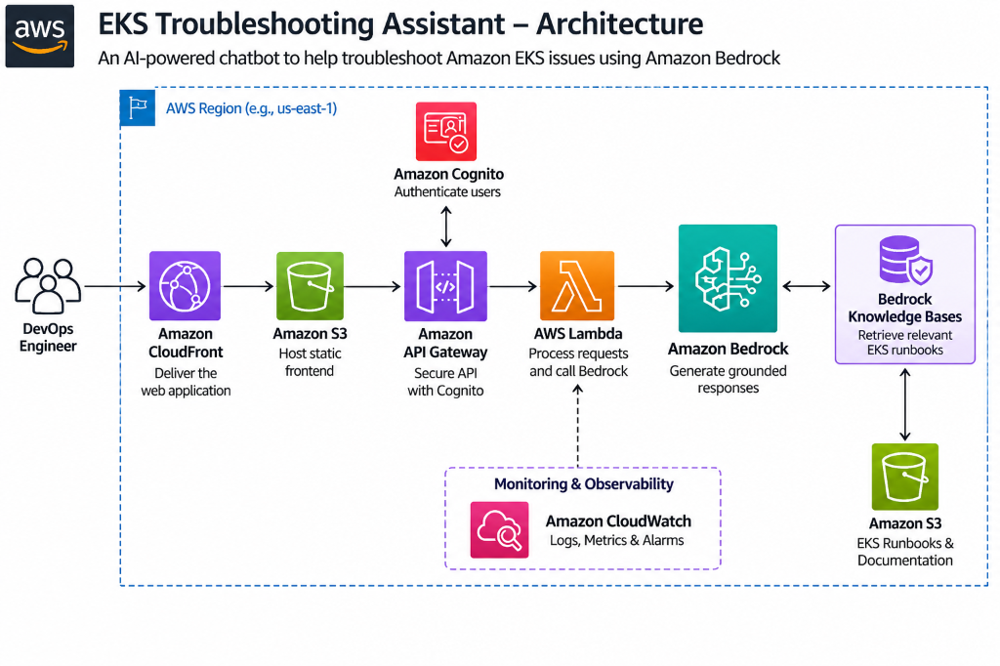
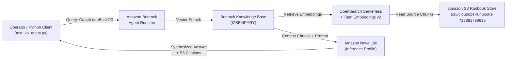
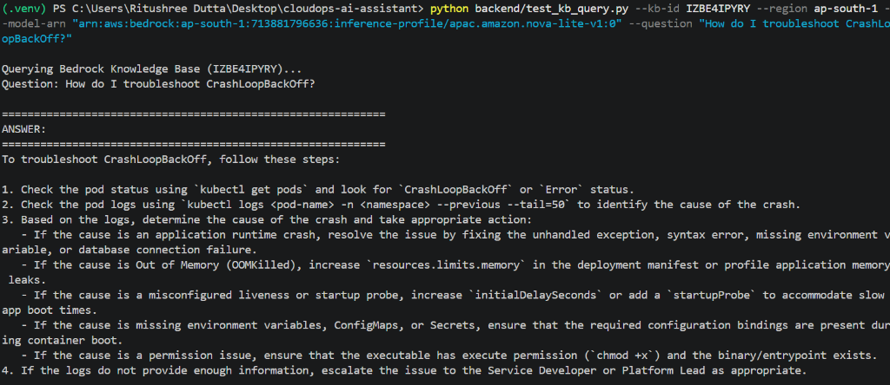
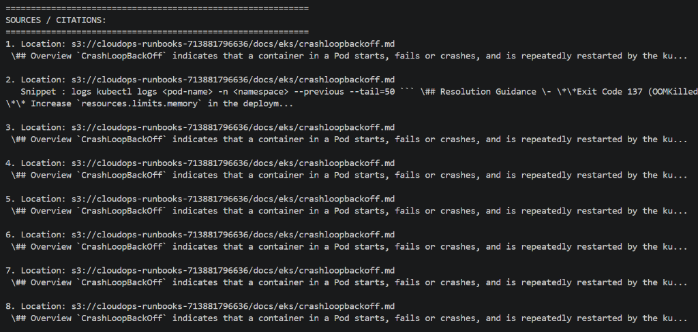

# Phase 1 Summary: CloudOps AI Assistant — Bedrock RAG & Runbook Grounding

## 📌 Executive Summary
In **Phase 1 (Milestone 1)**, we successfully established and verified the core AI retrieval-augmented generation (RAG) pipeline for the **CloudOps AI Assistant**. 

Instead of generating ungrounded or hallucinated answers, the assistant queries operational Kubernetes runbooks stored in **Amazon S3**, searches vector embeddings via **Amazon Titan Text Embeddings v2** on **Amazon OpenSearch Serverless**, and synthesizes an actionable troubleshooting response with citations using **Amazon Nova Lite**.

---

## 🏗️ Architecture Overview



### RAG Data Flow (Phase 1 Implemented)



---

## ⚙️ Configuration & Key Parameters

| Component | Identifier / Value | Description |
| :--- | :--- | :--- |
| **AWS Account ID** | `713881796636` | Dedicated AWS account |
| **AWS Region** | `ap-south-1` (Mumbai) | Target deployment region |
| **S3 Runbook Store** | `s3://cloudops-runbooks-713881796636/docs/eks/` | Source markdown runbook store |
| **Knowledge Base ID** | `IZBE4IPYRY` | Bedrock Knowledge Base |
| **Embeddings Model** | `Amazon Titan Text Embeddings v2` | Vector generation (1024 dims) |
| **Vector Store** | `Amazon OpenSearch Serverless` | Auto-managed vector index |
| **Inference Profile** | `arn:aws:bedrock:ap-south-1:713881796636:inference-profile/apac.amazon.nova-lite-v1:0` | APAC System Cross-Region Profile for Nova Lite |

---

## 🛠️ Execution Steps Performed

### 1. Document Preparation & S3 Sync
- Authored production-grade EKS operational runbooks (`pod-pending.md`, `crashloopbackoff.md`, `imagepullbackoff.md`, `node-notready.md`, `alb-ingress-504.md`).
- Synced documents to the dedicated S3 bucket:
  ```powershell
  aws s3 sync ./docs/ s3://cloudops-runbooks-713881796636/docs/
  ```

### 2. Knowledge Base & Vector Store Setup
- Created Bedrock Knowledge Base `IZBE4IPYRY` in `ap-south-1`.
- Associated S3 data source `cloudops-runbooks-s3`.
- Selected **Amazon Titan Text Embeddings v2** with managed OpenSearch Serverless collection.
- Executed initial **Sync / Ingestion job** to tokenize and chunk the markdown runbooks.

### 3. Model Routing & Inference Profile Resolution
- Initial test with raw on-demand model ARN returned:
  `ValidationException: Invocation of model ID amazon.nova-lite-v1:0 with on-demand throughput isn't supported.`
- Resolved by discovering and routing requests through the official Bedrock APAC Inference Profile:
  `arn:aws:bedrock:ap-south-1:713881796636:inference-profile/apac.amazon.nova-lite-v1:0`

### 4. Verification via Python Client
Executed the query against the live Knowledge Base:
```powershell
python backend/test_kb_query.py `
  --kb-id IZBE4IPYRY `
  --region ap-south-1 `
  --model-arn "arn:aws:bedrock:ap-south-1:713881796636:inference-profile/apac.amazon.nova-lite-v1:0" `
  --question "How do I troubleshoot CrashLoopBackOff?"
```

---

## 📸 Verified Results & Evidence

### Test 1: Grounded Troubleshooting Output Generated by Nova Lite
The model generated accurate diagnostic steps (inspecting `Exit Code 137 OOMKilled`, checking `kubectl logs --previous --tail=50`, reviewing liveness/startup probes, and checking exit codes 126/127):



```text
Querying Bedrock Knowledge Base (IZBE4IPYRY)...
Question: How do I troubleshoot CrashLoopBackOff?

============================================================
ANSWER:
============================================================
To troubleshoot CrashLoopBackOff, follow these steps:

1. Check the pod status using `kubectl get pods` and look for `CrashLoopBackOff` or `Error` status.
2. Check the pod logs using `kubectl logs <pod-name> -n <namespace> --previous --tail=50` to identify the cause of the crash.
3. Based on the logs, determine the cause of the crash and take appropriate action:
   - If the cause is an application runtime crash, resolve the issue by fixing the unhandled exception, syntax error, missing environment variable, or database connection failure.
   - If the cause is Out of Memory (OOMKilled), increase `resources.limits.memory` in the deployment manifest or profile application memory leaks.
   - If the cause is a misconfigured liveness or startup probe, increase `initialDelaySeconds` or add a `startupProbe` to accommodate slow app boot times.
   - If the cause is missing environment variables, ConfigMaps, or Secrets, ensure that the required configuration bindings are present during container boot.
   - If the cause is a permission issue, ensure that the executable has execute permission (`chmod +x`) and the binary/entrypoint exists.
4. If the logs do not provide enough information, escalate the issue to the Service Developer or Platform Lead as appropriate.
```

---

### Test 2: Grounded Citations & S3 Source Verification
The response verified source grounding by returning 8 granular citations pointing directly to `crashloopbackoff.md` in S3:



```text
============================================================
SOURCES / CITATIONS:
============================================================
1. Location: s3://cloudops-runbooks-713881796636/docs/eks/crashloopbackoff.md
2. Location: s3://cloudops-runbooks-713881796636/docs/eks/crashloopbackoff.md
   Snippet : logs kubectl logs <pod-name> -n <namespace> --previous --tail=50 ... ## Resolution Guidance - **Exit Code 137 (OOMKilled) ...
3. Location: s3://cloudops-runbooks-713881796636/docs/eks/crashloopbackoff.md
...
8. Location: s3://cloudops-runbooks-713881796636/docs/eks/crashloopbackoff.md
```

---

## 🧹 Teardown Completed

To prevent ongoing hourly charges from **Amazon OpenSearch Serverless** (~$0.24/hr):
1. **Bedrock Knowledge Base Deleted:** `IZBE4IPYRY` removed via CLI/Console.
2. **OpenSearch Serverless Collection Deleted:** Vector storage collection terminated.
3. **S3 Runbook Bucket Cleared:** S3 storage deleted or kept empty for the next iteration.

---

## 🚀 Next Milestone: Phase 2 (Serverless API Backend)
- **AWS Lambda Function:** Wrap `retrieve_and_generate` into an event-driven Python Lambda handler with input sanitization and CORS support.
- **Amazon API Gateway:** Expose a secure `POST /chat` endpoint with request throttling.
- **Cognito / JWT:** Configure authentication boundary.
- **Terraform Automation:** Codify S3, Lambda, IAM roles, and API Gateway into reproducible Infrastructure as Code.
