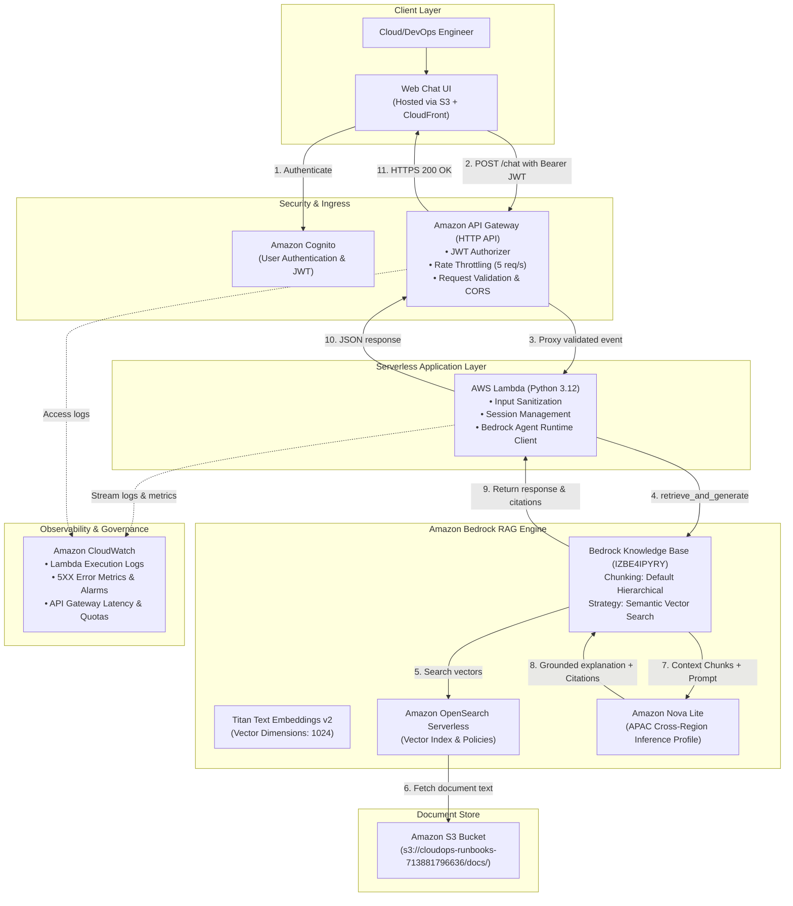

# CloudOps AI Assistant — End-to-End Project Workflow & Architecture

## 1. Project Overview & Objective
**CloudOps AI Assistant** is a serverless, GenAI-powered troubleshooting assistant built on **Amazon Bedrock**. It enables Cloud and DevOps engineers to diagnose AWS and Kubernetes infrastructure incidents (such as EKS pod issues, IAM access denials, and API Gateway failures) using grounded internal runbooks and architecture documentation.

---

## 2. Complete Project Folder Structure

```text
cloudops-ai-assistant/
├── .github/
│   └── workflows/
│       ├── test.yml                   # CI: Linting, unit tests, and validation
│       └── deploy.yml                 # CD: Terraform plan/apply on main merge
│
├── assets/
│   └── screenshots/                   # Verification artifacts & evaluation proofs
│       ├── 01_bedrock_nova_lite_answer.png
│       └── 02_bedrock_s3_citations.png
│
├── docs/                              # Operational Knowledge Corpus (S3 Source)
│   ├── eks/                           # EKS Troubleshooting Runbooks
│   │   ├── pod-pending.md
│   │   ├── crashloopbackoff.md
│   │   ├── imagepullbackoff.md
│   │   ├── node-notready.md
│   │   └── alb-ingress-504.md
│   ├── iam/                           # IAM & Permissions Runbooks
│   │   └── access-denied.md
│   └── api-gateway/                   # API Gateway & Network Runbooks
│       └── http-503.md
│
├── backend/                           # Serverless Python Backend
│   ├── src/
│   │   ├── __init__.py
│   │   ├── handler.py                 # AWS Lambda entrypoint (API Gateway proxy)
│   │   ├── kb_service.py              # Bedrock Agent Runtime integration logic
│   │   ├── validator.py               # Input validation & prompt sanitization
│   │   └── response_formatter.py      # Citation parser & JSON response builder
│   ├── tests/
│   │   ├── __init__.py
│   │   ├── test_handler.py            # Unit tests for Lambda handler
│   │   └── test_validator.py          # Security & input boundary tests
│   ├── test_kb_query.py               # Local CLI tool for direct Bedrock testing
│   └── requirements.txt               # Lambda runtime dependencies (boto3, pydantic)
│
├── frontend/                          # Client Web Interface
│   ├── index.html                     # Responsive Chat UI
│   ├── styles.css                     # Modern dark-mode DevOps aesthetic
│   ├── app.js                         # API caller, session manager & citation renderer
│   └── config.js                      # Environment configuration (API Gateway URL)
│
├── terraform/                         # Infrastructure as Code (IaC)
│   ├── environments/
│   │   ├── dev/
│   │   │   ├── main.tf                # Dev environment root module
│   │   │   ├── variables.tf
│   │   │   ├── outputs.tf
│   │   │   └── terraform.tfvars
│   │   └── prod/                      # Optional production configuration
│   └── modules/
│       ├── s3_knowledge_base/         # S3 runbooks bucket & bucket policy
│       ├── bedrock_kb/                # Bedrock Knowledge Base & OpenSearch Serverless
│       ├── lambda/                    # Python Lambda function, log group & IAM role
│       ├── api_gateway/               # HTTP API, routes, CORS & throttling
│       ├── cognito/                   # User Pool & App Client for JWT auth
│       ├── frontend_hosting/          # S3 static website bucket & CloudFront CDN
│       └── monitoring/                # CloudWatch Dashboard, metrics & alarms
│
├── eval/                              # Evaluation & Quality Assurance
│   ├── test_dataset.json              # 25-30 curated test questions across domains
│   ├── evaluate_retrieval.py          # Groundedness, relevance & latency benchmark
│   └── eval_results.md                # Published benchmark metrics for GitHub
│
├── .gitignore                         # Python, OS & Terraform ignore rules
├── LICENSE                            # Open source license
├── PHASE_1_SUMMARY.md                 # Phase 1 milestone proof of execution
├── WORKFLOW.md                        # This end-to-end workflow document
└── README.md                          # Portfolio-ready project documentation
```

---

## 3. End-to-End System Architecture



---

## 4. Phase-by-Phase Execution Roadmap

### 🟢 Phase 1: RAG & Bedrock Grounding [COMPLETED]
- [x] Authored 5 structured EKS runbooks with copyable diagnostic commands.
- [x] Uploaded runbooks to private S3 bucket (`cloudops-runbooks-713881796636`).
- [x] Provisioned Amazon Bedrock Knowledge Base with **Amazon Titan Text Embeddings v2** on **OpenSearch Serverless**.
- [x] Configured Amazon Bedrock APAC Inference Profile for **Amazon Nova Lite** (`apac.amazon.nova-lite-v1:0`).
- [x] Validated via Python SDK (`test_kb_query.py`): verified grounded answers and 8 granular S3 source citations.
- [x] Teardown performed to eliminate idle OpenSearch Serverless charges.

---

### 🟡 Phase 2: Serverless Python API Backend [NEXT]
- [ ] Create `backend/src/handler.py`:
  - Handle API Gateway HTTP POST events.
  - Parse request body (`{"message": "...", "sessionId": "..."}`).
  - Validate input length (e.g. 1-1000 characters) and sanitize against prompt injection.
  - Call Bedrock `retrieve_and_generate` using the tested Nova Lite profile.
  - Parse citation references (`location.s3Location.uri` and snippet text).
  - Return formatted JSON with CORS headers (`Access-Control-Allow-Origin: *`).
- [ ] Create least-privilege IAM Execution Role:
  - `bedrock:RetrieveAndGenerate` on specific Knowledge Base ARN.
  - `logs:CreateLogGroup`, `logs:CreateLogStream`, `logs:PutLogEvents`.
- [ ] Test Lambda locally with synthetic API Gateway event payloads.

---

### 🔵 Phase 3: Infrastructure as Code (Terraform)
- [ ] Structure Terraform into modular components (`terraform/modules/`):
  - **Storage:** S3 bucket for documents and S3 bucket for static web assets.
  - **IAM:** Lambda execution role and Bedrock service roles.
  - **Compute:** AWS Lambda function packaging Python zip.
  - **API Gateway:** HTTP API v2 with CORS, `/chat` route, integration, and throttling stages.
  - **Cognito:** User pool and client configuration.
- [ ] Implement `environments/dev/` with clean `terraform.tfvars`.
- [ ] Validate end-to-end teardown with `terraform destroy` for zero ongoing costs.

---

### 🟣 Phase 4: Frontend Web Interface
- [ ] Build clean, responsive single-page web UI (`frontend/`):
  - Chat window with message bubbles.
  - "Copy Command" button for safe `kubectl` and AWS CLI commands.
  - Clickable citation cards linking to runbook titles.
  - Feedback widget (👍 / 👎) for evaluation tracking.
  - Session state persistence for multi-turn troubleshooting conversations.
- [ ] Host frontend on private S3 origin fronted by Amazon CloudFront with HTTPS.

---

### 🔴 Phase 5: Evaluation, Security & Observability
- [ ] **Curated Benchmark Dataset:** 25-30 realistic incident scenarios:
  - 10 EKS queries (Pending, CrashLoopBackOff, ImagePullBackOff, Node NotReady, 504 Ingress).
  - 5 IAM scenarios (AccessDenied, SCP restrictions, KMS decryption issues).
  - 5 API Gateway scenarios (503 Service Unavailable, Lambda timeouts, throttling).
  - 5 Out-of-scope / Adversarial queries (prompt injection attempts, unrelated trivia).
- [ ] **Automated Evaluation Script:** `eval/evaluate_retrieval.py` measuring:
  - **Retrieval Relevance:** Did the expected runbook appear in the top-k citations?
  - **Groundedness:** Are claims directly derived from the runbook text?
  - **Latency:** Average end-to-end response time (p50 / p95).
  - **Cost per Query:** Calculated based on input/output tokens.
- [ ] **CloudWatch Monitoring:** Alarms on Lambda 5XX errors and Bedrock throttling.

---

## 5. Request-Response Data Contract

### API Request (`POST /chat`)
```json
{
  "message": "My EKS pods are stuck in Pending. What should I check?",
  "sessionId": "optional-uuid-string-for-context"
}
```

### API Response (`HTTP 200 OK`)
```json
{
  "answer": "To troubleshoot EKS pods in Pending state, follow these steps:\n1. Check pod events using `kubectl describe pod <pod-name> -n <namespace>`.\n2. Review cluster node allocatable CPU and Memory.\n3. Check persistent volume claim (PVC) binding status.",
  "sessionId": "d82f7c40-1234-5678-90ab-cdef12345678",
  "sources": [
    {
      "title": "EKS Pod Pending Runbook",
      "location": "s3://cloudops-runbooks-713881796636/docs/eks/pod-pending.md",
      "snippet": "A Kubernetes Pod remains in the Pending phase when it has been accepted by the Kubernetes API server..."
    }
  ]
}
```

### Error Response (`HTTP 400 Bad Request`)
```json
{
  "error": "ValidationException",
  "message": "Message exceeds maximum allowed length of 1000 characters."
}
```

---

## 6. Security & Cost Safeguards

1. **Least Privilege:** Lambda execution role has zero infrastructure modification rights; it is strictly a read-only knowledge assistant.
2. **Untrusted Retrieval:** Retrieved documentation chunks are treated as untrusted text, preventing prompt injection through malicious runbook content.
3. **Throttling & Quotas:** API Gateway limits requests to 5 req/sec burst to eliminate denial-of-wallet risks.
4. **Active Teardown Strategy:** Terraform-managed OpenSearch Serverless and Bedrock resources can be spun down after testing or portfolio demonstrations.
